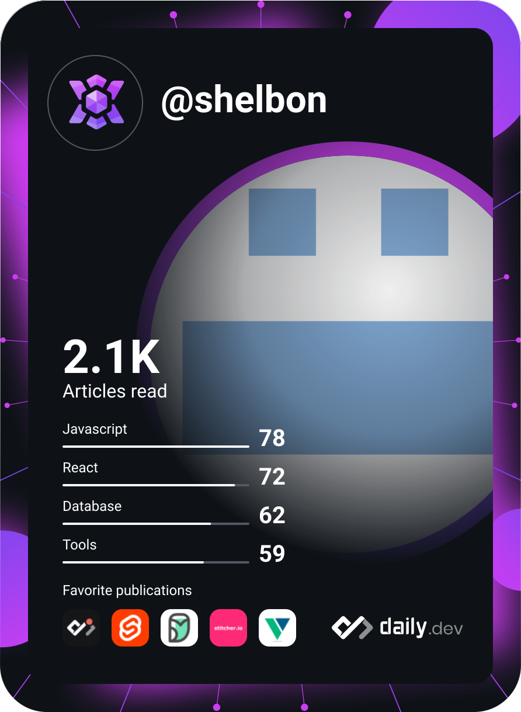
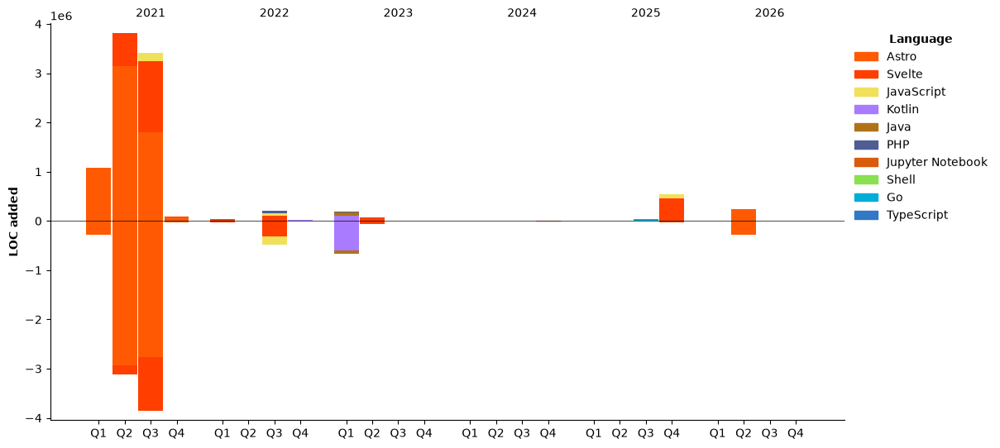

 
  <div align="left">
  <h1 align="left"> Hi 👋, I'm Patrick Sheron Moucle</h1>
<a     href="https://app.daily.dev/shelbon"></a>

- Other version control: [https://gitlab.com/shelbon](https://gitlab.com/shelbon)
- 👨‍💻 All of my projects are available at [https://www.mouclepatrick.com/](https://www.mouclepatrick.com/)

- 📫 How to reach me **dev@mouclepatrick.com**

<h3 align="left">Connect with me:</h3>
<p align="left">
<a href="https://linkedin.com/in/https://www.linkedin.com/in/patrick-sheron-moucle/" target="blank"  ></a>
</p>

<h3 align="left">Languages and Tools:</h3>
 
 [](https://skillicons.dev)

[My dev passport](https://passeport.dev/p/e96cf336-11d7-4edd-916d-11af626333a8)
<!--START_SECTION:waka-->


**I'm a Night 🦉** 

```text
🌞 Morning                337 commits         █░░░░░░░░░░░░░░░░░░░░░░░░   03.77 % 
🌆 Daytime                3441 commits        ██████████░░░░░░░░░░░░░░░   38.45 % 
🌃 Evening                4597 commits        █████████████░░░░░░░░░░░░   51.36 % 
🌙 Night                  575 commits         ██░░░░░░░░░░░░░░░░░░░░░░░   06.42 % 
```
📅 **I'm Most Productive on Sunday** 

```text
Monday                   1579 commits        ████░░░░░░░░░░░░░░░░░░░░░   17.64 % 
Tuesday                  1667 commits        █████░░░░░░░░░░░░░░░░░░░░   18.63 % 
Wednesday                1457 commits        ████░░░░░░░░░░░░░░░░░░░░░   16.28 % 
Thursday                 852 commits         ██░░░░░░░░░░░░░░░░░░░░░░░   09.52 % 
Friday                   645 commits         ██░░░░░░░░░░░░░░░░░░░░░░░   07.21 % 
Saturday                 715 commits         ██░░░░░░░░░░░░░░░░░░░░░░░   07.99 % 
Sunday                   2035 commits        ██████░░░░░░░░░░░░░░░░░░░   22.74 % 
```


📊 **This Week I Spent My Time On** 

```text
🕑︎ Time Zone: Europe/Paris

💬 Programming Languages: 
Markdown                 20 hrs 27 mins      ████████░░░░░░░░░░░░░░░░░   32.27 % 
Other                    11 hrs 12 mins      ████░░░░░░░░░░░░░░░░░░░░░   17.68 % 
Rust                     9 hrs 29 mins       ████░░░░░░░░░░░░░░░░░░░░░   14.97 % 
Python                   4 hrs 48 mins       ██░░░░░░░░░░░░░░░░░░░░░░░   07.59 % 
JavaScript               4 hrs 38 mins       ██░░░░░░░░░░░░░░░░░░░░░░░   07.33 % 

🔥 Editors: 
Neovim                   39 hrs 11 mins      ███████████████░░░░░░░░░░   61.84 % 
Claude Code              24 hrs 2 mins       █████████░░░░░░░░░░░░░░░░   37.94 % 
Vim                      5 mins              ░░░░░░░░░░░░░░░░░░░░░░░░░   00.13 % 
Codex CLI                3 mins              ░░░░░░░░░░░░░░░░░░░░░░░░░   00.09 % 

💻 Operating System: 
Linux                    63 hrs 22 mins      █████████████████████████   100.00 % 
```

🤖 **AI Coding This Week** 

```text
⏱ AI Coding Time: 62 hrs 59 mins (99.38%)

✍️ 12,378 lines written by AI, 36 lines written by hand (99.71% AI-written)

🔤 45,187,129 Input Tokens, 6,264,806 Output Tokens

💵 $536.85 Estimated AI Cost This Week

🧠 1041 AI Sessions, 2191 AI Prompts

GPT                      8,173 lines         ████████████████░░░░░░░░░   63.76 % 
Opus                     3,642 lines         ███████░░░░░░░░░░░░░░░░░░   28.41 % 
Fable                    604 lines           █░░░░░░░░░░░░░░░░░░░░░░░░   04.71 % 
Sonnet                   400 lines           █░░░░░░░░░░░░░░░░░░░░░░░░   03.12 % 

🔎 AI Coding Insights:
🤖 AI-Driven — 99.71% of written lines came from AI
📚 Verbose Prompter — average 5,007 characters per prompt
🔁 Iterative Prompter — average 2 prompts per session
🚀 High AI Trust — 0.3% of changed lines were hand-edited
```

**I Mostly Code in Java** 

```text
Java                     4 repos             █████░░░░░░░░░░░░░░░░░░░░   20.00 % 
Kotlin                   4 repos             █████░░░░░░░░░░░░░░░░░░░░   20.00 % 
Go                       1 repo              █░░░░░░░░░░░░░░░░░░░░░░░░   05.00 % 
TypeScript               1 repo              █░░░░░░░░░░░░░░░░░░░░░░░░   05.00 % 
Shell                    1 repo              █░░░░░░░░░░░░░░░░░░░░░░░░   05.00 % 
```


**Timeline**




 Last Updated on 01/11/2026 10:57:07 UTC
<!--END_SECTION:waka--> 

